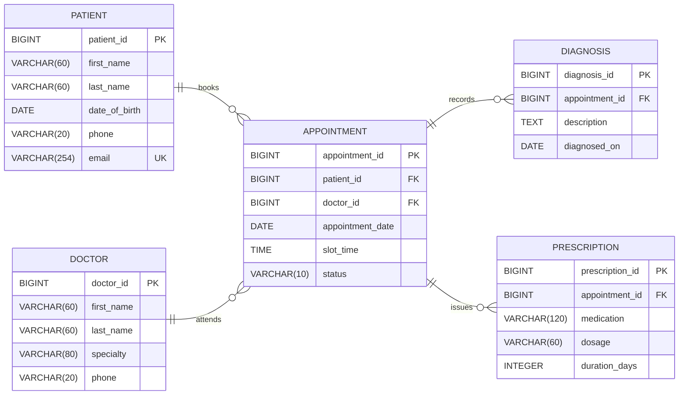

# Greenfield Family Clinic ER Diagram

## Reading the diagram

The diagram shows the five tables of the clinic design, with the tables flowing from left to right. Each box is a table, and each line is a relationship.

**Keys**
- **PK (primary key):** the field that uniquely identifies each row, such as `patient_id`.
- **FK (foreign key):** a field that points to the primary key of another table. `appointment.patient_id` points to `patient.patient_id`, which ties each appointment to one patient.
- **UK (unique key):** a field whose values cannot repeat. `patient.email` is unique, so no two patients share an email address.

**Relationship symbols**
- `||` means **exactly one**.
- `o|` means **zero or one**. No relationship in this design uses it.
- `o{` means **zero or many**.

Every relationship here is written `||--o{`: exactly one on the left, zero or many on the right. So `PATIENT ||--o{ APPOINTMENT` reads: one patient has zero or more appointments, and each appointment belongs to exactly one patient.

**Example:** Amina Bello (one patient) books Monday 10:00 with Dr Adams (one doctor). That creates one appointment row holding Amina's `patient_id` and Dr Adams' `doctor_id`. After the visit, one diagnosis row and two prescription rows can link back to that appointment. A visit with no prescriptions is also valid, because the relationship is zero or many.

## Optional fields

No field in the design is optional. Every field is required (`NOT NULL`). What is optional is the existence of child rows: an appointment may have zero diagnoses or zero prescriptions.

## Rules that need more than the diagram

An ER diagram shows structure, not every business rule. These rules need additional constraints or transaction logic:
- **Rules 4 and 5 (no double-booking):** partial unique indexes that ignore cancelled appointments.
- **Rule 6 (valid status):** a CHECK constraint limiting status to Booked, Completed or Cancelled.
- **Rule 8 (diagnosis or prescription only for a Completed appointment):** the foreign key guarantees the appointment exists, but a trigger or transaction logic must check its status.
- **Rule 9 (duration above zero):** a CHECK constraint on `duration_days`.