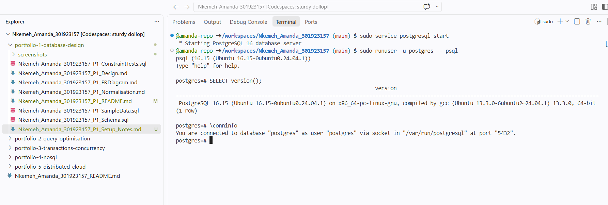

# PostgreSQL Setup Notes

## Environment

- Platform: GitHub Codespaces (Ubuntu 24.04 Linux)
- Database server: PostgreSQL 16.15, installed with apt
- Client: psql, run as the postgres user
- Database name: greenfield_clinic_portfolio

## Installation and start

```bash
sudo apt-get update
sudo apt-get install -y postgresql postgresql-contrib
sudo service postgresql start
```

The start command prints "Starting PostgreSQL 16 database server" when the server comes up.

## Starting a session

```bash
sudo runuser -u postgres -- psql
```

This opens psql as the postgres administrator account through the local system, so no database password is stored in the repository. A new session opens in the default postgres database. I then switch to the clinic database:

```sql
\c greenfield_clinic_portfolio
```

The clinic database was created once with:

```sql
CREATE DATABASE greenfield_clinic_portfolio;
```

## Checks

```sql
SELECT version();
\conninfo
```

The output confirms PostgreSQL 16.15 (Ubuntu 16.15-0ubuntu0.24.04.1), and that the session is connected as user postgres through a socket in /var/run/postgresql on port 5432. The screenshot below was taken in the default postgres database, before switching to the clinic database.



After the schema is created, `\dt` lists the five clinic tables.

## Restarting

Codespaces stops PostgreSQL when the codespace restarts. Running `sudo service postgresql start` brings it back. The data stays in the codespace unless the codespace is deleted, so the SQL scripts in this folder are kept to rebuild the database.